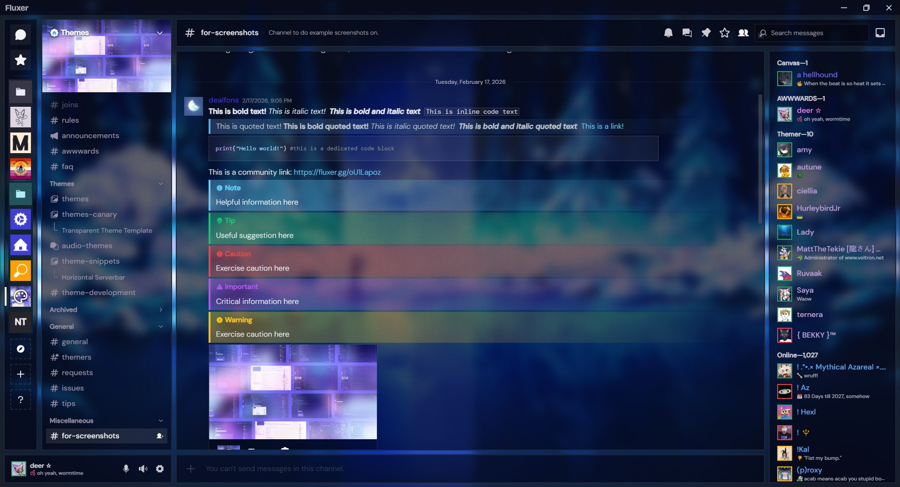
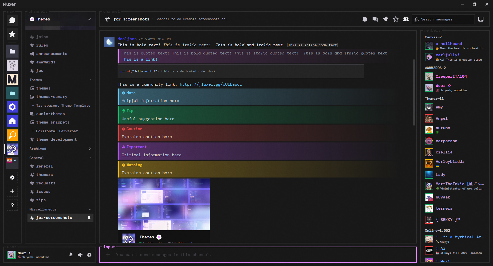
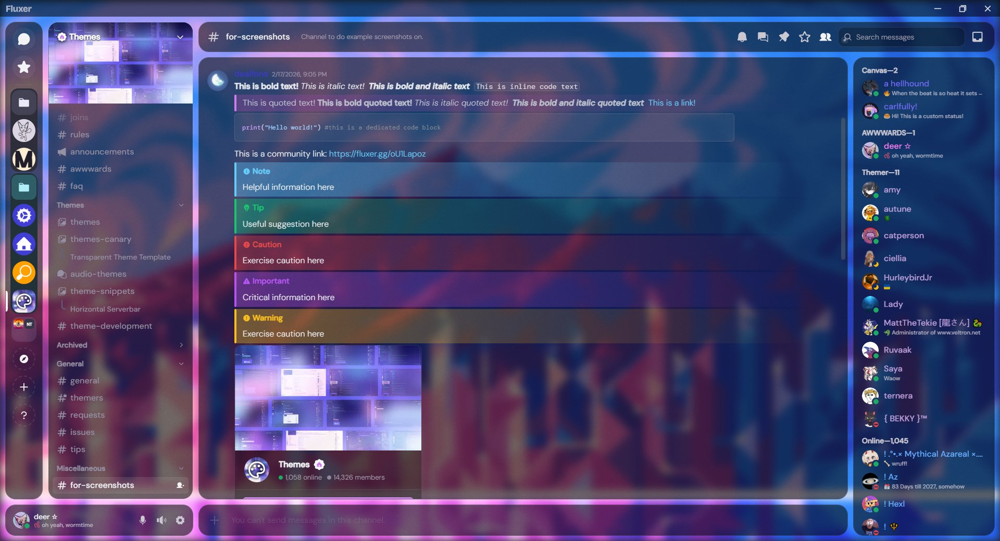
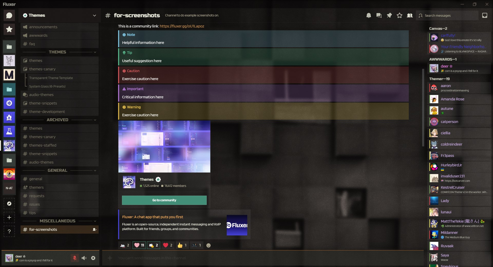
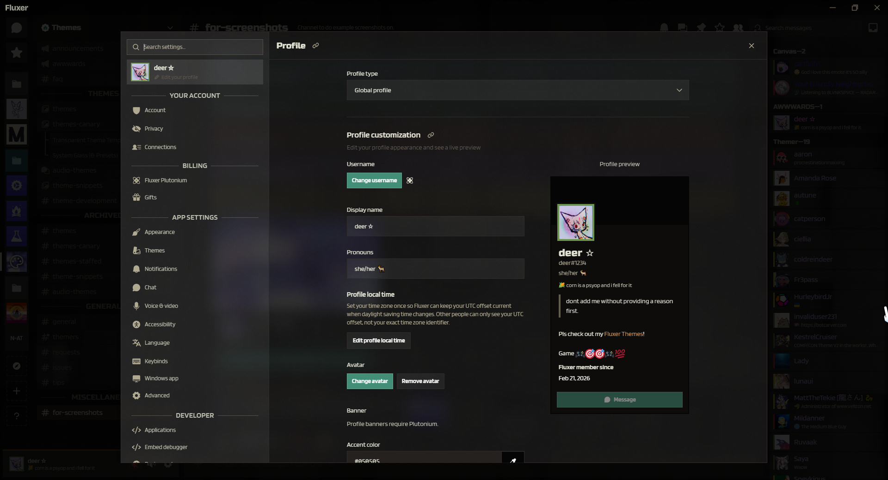
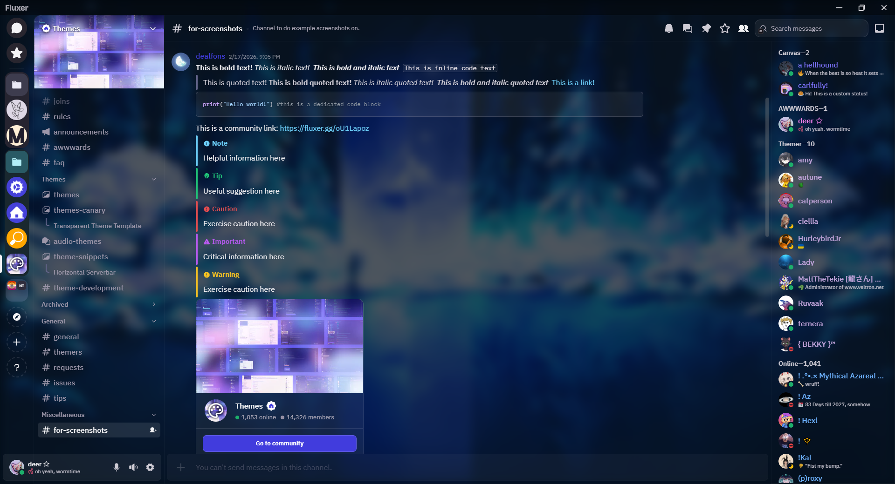

## Installation
simply click one of the theme preset links. fluxer should automatically open and prompt you to apply the theme. 

# System-Glass Theme
a highly customizable frosted glass theme for fluxer, based on refact0r's tui style discord theme [system24](https://github.com/refact0r/system24/).

### Presets
- System-Glass: 			https://canary.fluxer.com/theme/824a181be20bf4d2
- Terminal: 				https://canary.fluxer.com/theme/bc3dc690d589d117
- Crystal: 					https://canary.fluxer.com/theme/b8334e90a67d1dd5

### Customization
All customization options are located inside the first body {} and :root {} tags. every option is clearly labeled and comes with descriptions. 

Hopefully as fluxer grows the developers will losen some import restrictions to further improve this theme's customizability through presets.

### Credits
- backgrounds: [ThaSilentArtist](https://www.pixilart.com/thasilentartist)
- small CSS snippets: [refact0r](https://github.com/refact0r/)

## System Glass Screenshots

---
---

# rat.drome Theme
created for a commission. inspired by soviet brutalist architecture & russian constructivism. NOTE: this theme requires you to allow content from githubusercontent.com

### Presets
- theme: https://canary.fluxer.com/theme/e3f00a8de0c3f380

## rat.drome Screenshots

# Transparent Theme Template
Customizable transparent theme template that can also serve as a standalone theme if you just want to add a background image to the client. i've added a lot of comments so hopefully it won't be hard to modify. also supports the built in "coal" and "light" themes. check my github repo for updates

